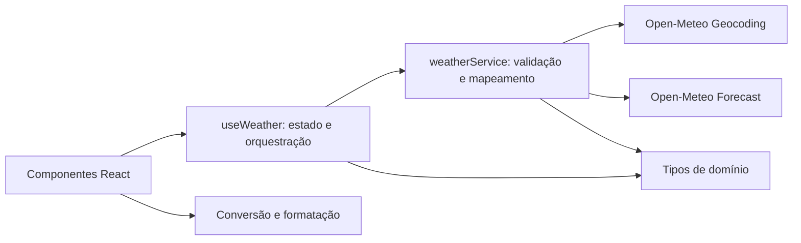

# Plano técnico — aplicativo de previsão do tempo

**Origem:** [especificação do produto](../specs/weather-app-spec.md), requisitos RF-01 a RF-06. Este plano descreve a evolução da base existente; não substitui decisões de produto ainda em aberto na spec.

## Architecture (Overview)

Aplicação React executada no navegador, sem backend próprio. A interface delega a orquestração a um hook; o serviço consulta a Open-Meteo e transforma respostas externas em dados de domínio. Funções puras cuidam de conversão, formatação e descrição dos códigos meteorológicos.



- **RF-01:** busca e seleção explícita de resultados distinguíveis.
- **RF-02, RF-03:** serviço fornece clima atual e cinco dias à interface.
- **RF-04:** dados em Celsius no domínio, conversão na apresentação.
- **RF-05, RF-06:** estados compreensíveis, acessíveis e interface responsiva.
- A base atual seleciona o primeiro resultado automaticamente e não expõe a seleção no `App`; adaptar o fluxo para respeitar a escolha da pessoa. A implementação atual também precisa proteger consultas concorrentes e validar respostas parciais.

## Tech Stack

| Tecnologia | Papel e justificativa |
| --- | --- |
| React 19 + TypeScript strict | Componentes acessíveis e contratos tipados, conforme a stack existente. |
| Vite | Desenvolvimento e build da aplicação cliente. |
| Tailwind CSS | Layout responsivo e integração com o tema existente. |
| Fetch + Open-Meteo | Consultas HTTP no navegador, sem chave de API para o uso previsto; confirmar limites e condições de uso para implantação. |
| Vitest + Testing Library | Testes de funções, serviço, hook e interface orientados a comportamento. |
| Playwright | Testes de fluxos completos e viewport móvel. |
| pnpm + Biome | Gerenciamento de dependências e lint conforme o repositório. |

## Project Structure

| Caminho | Responsabilidade |
| --- | --- |
| `src/App.tsx` | Compor a tela e manter a unidade de exibição. |
| `src/components/` | Busca, seleção de cidade, clima atual, lista de previsão e alternância de unidade. |
| `src/components/states/` | Apresentação dos estados vazio, carregando e erro. |
| `src/hooks/useWeather.ts` | Orquestrar busca, seleção, consultas, concorrência e nova tentativa. |
| `src/services/weatherService.ts` | Acesso às APIs, timeout, validação e mapeamento das respostas. |
| `src/types/weather.ts` | Contratos de cidade, clima, previsão e unidade. |
| `src/lib/` | Conversão de temperatura, formatação e códigos meteorológicos. |
| `tests/unit/` e `tests/e2e/` | Testes de unidades/componentes e jornadas completas, respectivamente. |

Reutilizar os arquivos existentes; introduzir componente de seleção apenas se necessário para manter responsabilidades claras.

## Data Model

Contratos de domínio propostos, alinhados aos tipos existentes. Campos adicionais não são exigências de produto; devem ser exibidos apenas após confirmação do escopo.

```ts
type Unit = 'celsius' | 'fahrenheit';

interface City {
  id: number;
  name: string;
  country: string;
  admin1?: string;
  latitude: number;
  longitude: number;
}

interface CurrentWeather {
  time: string;
  temperature: number; // Celsius
  weatherCode: number;
}

interface ForecastDay {
  date: string; // data civil da cidade, YYYY-MM-DD
  min: number; // Celsius
  max: number; // Celsius
  weatherCode: number;
}

interface WeatherData {
  city: City;
  current: CurrentWeather;
  forecast: ForecastDay[];
}
```

- Exigir cinco entradas diárias válidas para considerar a previsão completa. Mínima e máxima são dados disponíveis na API e na base atual; sua apresentação e o recorte de dias aguardam decisão de produto.
- Não converter ausência de dados em valor meteorológico válido. Campos opcionais adicionais, como probabilidade de precipitação, devem preservar indisponibilidade, não virar zero.
- Datas diárias são datas civis, não instantes UTC; preservar a data retornada para evitar deslocamento por fuso do dispositivo. O fuso de referência depende da decisão de produto.

## Data Flow

1. A pessoa informa uma cidade; a interface rejeita texto vazio ou composto apenas por espaços (RF-01, RF-05).
2. `useWeather` solicita resultados a `searchCities`; o serviço codifica a consulta, valida a resposta e devolve cidades normalizadas. A interface lista opções com cidade, região e país disponíveis (RF-01).
3. Após seleção explícita, o hook chama `getWeather` com as coordenadas; o serviço valida e mapeia clima atual e previsão para tipos de domínio (RF-02, RF-03).
4. O hook publica o estado da consulta e os dados da cidade selecionada. Resultados de requisições antigas são cancelados ou ignorados; não devem substituir a seleção mais recente (RF-05).
5. Os componentes exibem os dados em Celsius ou os convertem para Fahrenheit conforme a unidade vigente, inclusive se ela mudar durante o carregamento. A troca não gera nova consulta (RF-04).
6. Falhas e ausência de resultados são mostradas com ação apropriada; nova tentativa repete a operação que falhou, com seus próprios parâmetros (RF-05).

## External APIs

- **Geocoding:** `GET https://geocoding-api.open-meteo.com/v1/search` com `name`, `count`, `language` e `format=json`. Mapear `results` para cidades; ausência de resultados representa lista vazia. Distinguir resultados pelo nome e pelas informações de região e país disponíveis.
- **Forecast:** `GET https://api.open-meteo.com/v1/forecast` com `latitude`, `longitude`, `current=temperature_2m,weather_code`, `daily=weather_code,temperature_2m_min,temperature_2m_max`, `forecast_days` e `timezone`. A base atual também solicita umidade, vento, pressão, precipitação e probabilidade de precipitação; a necessidade de exibi-los permanece em aberto.
- A base usa `forecast_days=5` e `timezone=auto`; isso é uma opção técnica existente, não aprovação de que o dia atual e o fuso local sejam os desejados. Ajustar o intervalo e o fuso após decisão de produto.
- Usar HTTPS, parâmetros codificados e validação em tempo de execução dos campos necessários, inclusive comprimentos e valores das séries diárias. A ausência de chave não elimina a necessidade de verificar limites e termos aplicáveis.

## State Management

- Estado local React, sem biblioteca global: unidade na composição da tela; consulta, resultados, cidade selecionada, dados e estado de operação em `useWeather`.
- Modelar busca e consulta meteorológica de modo que `idle`, `loading`, `empty`, `success` e `error` sejam identificáveis para cada operação. Conservar a última operação e seus parâmetros para retry correto.
- Cada nova busca ou seleção invalida a requisição anterior por cancelamento e/ou identificador monotônico; inclusive falhas de requisições antigas não devem alterar o estado atual.
- A unidade permanece durante a sessão e a troca de cidade; persistência entre visitas está fora do escopo atual. A unidade inicial depende da resposta de produto.
- Não associar dados da cidade anterior à nova seleção durante carregamento ou erro; limpar ou identificar claramente os dados anteriores.

## Error Handling

- **Entrada vazia:** não consultar; solicitar um nome de cidade. **Sem resultados:** apresentar estado vazio e permitir nova busca.
- **HTTP, rede, JSON inválido ou timeout:** converter em erro de domínio compreensível; permitir repetir a operação que falhou. A base usa timeout de 10 segundos; tratá-lo como provisório até a definição da meta.
- **Dados parciais ou inválidos:** identificar indisponibilidade e nunca representar uma previsão incompleta como completa. A decisão sobre exibir partes válidas continua em aberto; até então, não pressupor apresentação parcial.
- **Cancelamento por nova consulta:** descartar silenciosamente o resultado ou erro obsoleto; não confundir com timeout ou falha da consulta ativa.
- **Acessibilidade:** rótulos e foco visível, operação por teclado e anúncio dos estados relevantes a tecnologias assistivas. Preservar acesso aos controles em telas móveis.

## Testing Strategy

| Cobertura | Casos principais |
| --- | --- |
| Vitest: serviço e funções | Busca vazia, codificação e homônimos; rede, HTTP, timeout e JSON inválido; validação de séries incompletas e valores ausentes; conversão C/F e formatação de datas sem deslocamento. |
| Vitest + Testing Library: hook e componentes | Seleção explícita, loading, vazio e erro; retry da operação correta; troca de unidade durante consulta; respostas fora de ordem; rótulos, foco e interação por teclado. |
| Playwright: fluxo completo | Busca, seleção entre homônimos, clima atual, cinco dias e alternância de unidade; falhas e nova tentativa; execução em viewport móvel sem sobreposição ou rolagem horizontal. |

Usar respostas HTTP controladas nos testes para reproduzir sucesso, ausência, falhas e concorrência sem depender da rede. Testes de parciais devem verificar que dados faltantes não são exibidos como completos. Executar `pnpm lint`, `pnpm build`, `pnpm test` e `pnpm test:e2e` quando as respectivas mudanças forem implementadas; a documentação isolada não exige esses comandos.

## Risks & Trade-offs

| Risco ou decisão | Impacto e encaminhamento |
| --- | --- |
| Datas e fuso ainda indefinidos | Pode mudar o período consultado e os resultados esperados; confirmar se inclui hoje e qual fuso usar antes de fechar testes de aceite. |
| Dados diários e atuais adicionais indefinidos | A API oferece mínima, máxima e outros campos, mas não há decisão sobre exibição; obter aprovação antes de ampliar a interface. |
| API externa e acesso direto pelo navegador | Simplicidade e ausência de backend, em troca de dependência de rede, disponibilidade, limites e condições do provedor; verificar termos e tratar falhas. |
| Respostas incompletas | A implementação atual só verifica a presença de `current` e `daily` e transforma probabilidade ausente em zero; validar campos e preservar ausência. A política de exibição parcial aguarda produto. |
| Respostas fora de ordem e retry | O hook atual não protege concorrência e pode repetir a cidade anterior após falha de busca; identificar a operação e invalidar respostas antigas. |
| Homônimos | A base seleciona automaticamente o primeiro resultado; oferecer escolha identificável antes da consulta meteorológica. |
| Metas e suporte indefinidos | Acessibilidade formal, navegadores, desempenho, timeout e unidade inicial precisam de decisões; não declarar conformidade ou meta quantitativa sem validação. |
| Celsius como representação canônica | Evita requisição ao alternar unidades, mas exige conversão consistente e arredondamento testado em todas as temperaturas exibidas. |

**Próxima etapa:** esclarecer as perguntas em aberto da spec e decompor o plano em tarefas; nenhuma alteração de código é proposta nesta etapa.